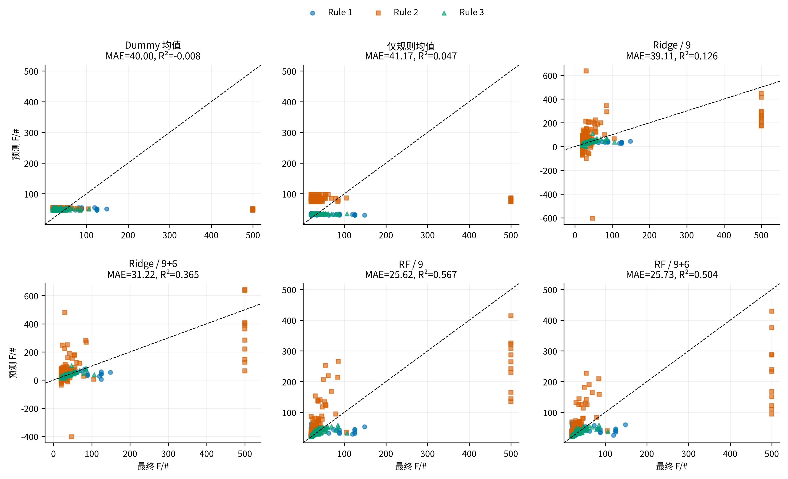
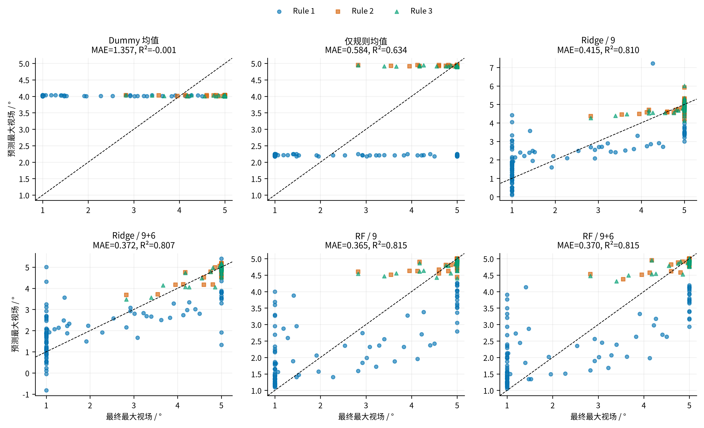
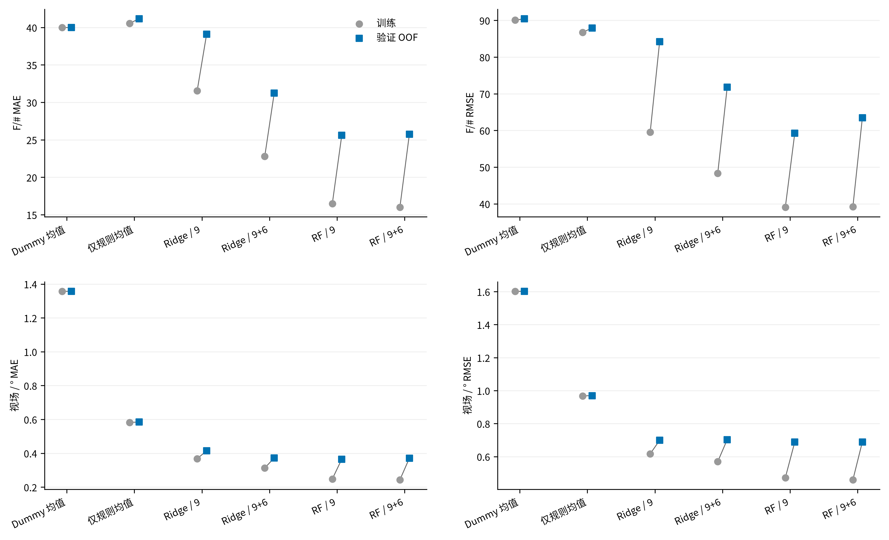
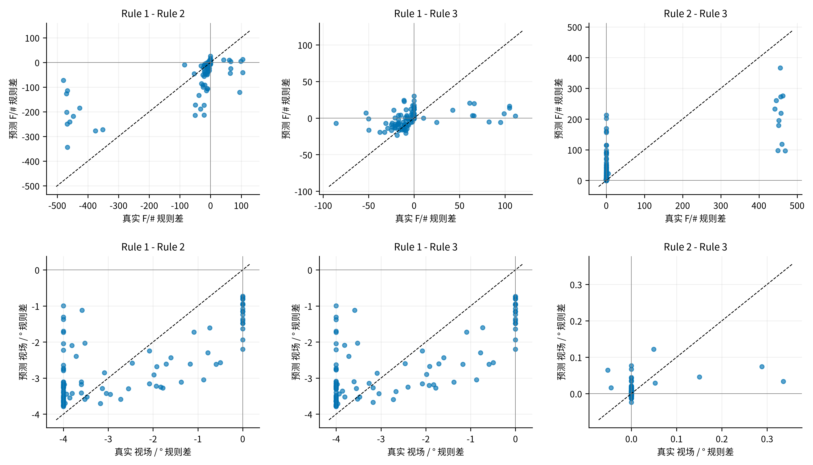

# Zemax 优化规则条件化回归：第一版实验

## 结论

第一批 100 套处方已经包含可预测信号。Random Forest 使用原始 9 参数时，两项输出都稳定优于仅按规则编号取训练折均值的基线；但性能还不足以把模型当作高精度 Zemax 替代器。F/# 的困难主要集中在 Rule 2 的长尾极值，视场总体 R² 又部分来自三条规则之间本来就很大的均值差异。

物理派生特征对 Ridge 明显有帮助，对 Random Forest 没有带来总体改善；因此不能笼统地说派生特征有效。Ridge 还产生了负 F/#、负视场及超出合理范围的外推，当前更适合解释线性增量，而不适合直接部署。

## 数据与验证设计

只读取 `feature_engineering_100_v1`：100 个处方 × 3 条规则，共 300 行。输入只含优化前参数和规则编号；输出为最终 F/#、最大视场。第二批数据未读取，历史结果未修改，也未生成最优规则标签。

原始特征为 5 个采样参数和论文映射得到的 4 个参数。扩展组增加 6 个无量纲量：间距/|EFL|、两片功率比与功率平衡、初始空气间隔/|EFL|、物距/|EFL|、像距/|EFL|。规则采用 one-hot 条件展开并与各特征相乘，使同一模型可学习规则特异的斜率。

采用固定随机种子的五折 GroupKFold，每折验证 20 套完整处方（60 行），同一处方的三条规则始终位于同一折。标准化仅在 Ridge 的训练折拟合。Random Forest 固定 500 棵树、叶节点最少 3 个样本、`max_features=sqrt`；未调参。

除标准 Dummy 均值外，加入了训练折内逐规则均值基线。后者才是‘仅根据规则编号预测’的直接比较对象。

## 总体 OOF 指标

| 输出 | 模型 | 特征 | MAE | RMSE | R² |
|---|---|---|---:|---:|---:|
| 最终 F/# | Dummy 均值 | rule_only | 40.00 | 90.46 | -0.008 |
| 最终 F/# | 仅规则均值 | rule_only | 41.17 | 87.94 | 0.047 |
| 最终 F/# | Ridge / 9 | raw9 | 39.11 | 84.21 | 0.126 |
| 最终 F/# | Ridge / 9+6 | raw9_plus_physics6 | 31.22 | 71.82 | 0.365 |
| 最终 F/# | RF / 9 | raw9 | 25.62 | 59.27 | 0.567 |
| 最终 F/# | RF / 9+6 | raw9_plus_physics6 | 25.73 | 63.46 | 0.504 |
| 最终最大视场 / ° | Dummy 均值 | rule_only | 1.357 | 1.602 | -0.001 |
| 最终最大视场 / ° | 仅规则均值 | rule_only | 0.584 | 0.969 | 0.634 |
| 最终最大视场 / ° | Ridge / 9 | raw9 | 0.415 | 0.699 | 0.810 |
| 最终最大视场 / ° | Ridge / 9+6 | raw9_plus_physics6 | 0.372 | 0.703 | 0.807 |
| 最终最大视场 / ° | RF / 9 | raw9 | 0.365 | 0.689 | 0.815 |
| 最终最大视场 / ° | RF / 9+6 | raw9_plus_physics6 | 0.370 | 0.689 | 0.815 |

OOF 表示每个处方只由未见过该处方的训练折模型预测一次。

各预测散点面板均画出 y=x 参考线；为了完整显示 Ridge 的非物理外推，各面板纵轴独立取值，比较模型时应以标注指标和点到参考线的距离为准。

## 逐规则 OOF 指标

| 输出 | 模型 | 特征 | 规则 | MAE | RMSE | R² |
|---|---|---|---:|---:|---:|---:|
| 最终 F/# | Dummy 均值 | rule_only | 1 | 30.69 | 33.56 | -0.412 |
| 最终 F/# | Dummy 均值 | rule_only | 2 | 69.01 | 151.3 | -0.061 |
| 最终 F/# | Dummy 均值 | rule_only | 3 | 20.30 | 23.22 | -1.032 |
| 最终 F/# | 仅规则均值 | rule_only | 1 | 18.10 | 28.77 | -0.038 |
| 最终 F/# | 仅规则均值 | rule_only | 2 | 93.09 | 148.7 | -0.025 |
| 最终 F/# | 仅规则均值 | rule_only | 3 | 12.32 | 16.32 | -0.004 |
| 最终 F/# | Ridge / 9 | raw9 | 1 | 18.31 | 29.23 | -0.071 |
| 最终 F/# | Ridge / 9 | raw9 | 2 | 92.35 | 142.4 | 0.060 |
| 最终 F/# | Ridge / 9 | raw9 | 3 | 6.682 | 12.13 | 0.445 |
| 最终 F/# | Ridge / 9+6 | raw9_plus_physics6 | 1 | 16.18 | 27.56 | 0.048 |
| 最终 F/# | Ridge / 9+6 | raw9_plus_physics6 | 2 | 71.77 | 120.8 | 0.323 |
| 最终 F/# | Ridge / 9+6 | raw9_plus_physics6 | 3 | 5.725 | 10.70 | 0.568 |
| 最终 F/# | RF / 9 | raw9 | 1 | 15.86 | 26.78 | 0.101 |
| 最终 F/# | RF / 9 | raw9 | 2 | 54.68 | 98.49 | 0.550 |
| 最终 F/# | RF / 9 | raw9 | 3 | 6.318 | 10.98 | 0.546 |
| 最终 F/# | RF / 9+6 | raw9_plus_physics6 | 1 | 14.56 | 26.04 | 0.150 |
| 最终 F/# | RF / 9+6 | raw9_plus_physics6 | 2 | 56.46 | 106.2 | 0.476 |
| 最终 F/# | RF / 9+6 | raw9_plus_physics6 | 3 | 6.180 | 10.65 | 0.572 |
| 最终最大视场 / ° | Dummy 均值 | rule_only | 1 | 2.188 | 2.423 | -1.247 |
| 最终最大视场 / ° | Dummy 均值 | rule_only | 2 | 0.941 | 0.956 | -8.953 |
| 最终最大视场 / ° | Dummy 均值 | rule_only | 3 | 0.942 | 0.956 | -7.663 |
| 最终最大视场 / ° | 仅规则均值 | rule_only | 1 | 1.456 | 1.618 | -0.002 |
| 最终最大视场 / ° | 仅规则均值 | rule_only | 2 | 0.141 | 0.306 | -0.022 |
| 最终最大视场 / ° | 仅规则均值 | rule_only | 3 | 0.155 | 0.328 | -0.021 |
| 最终最大视场 / ° | Ridge / 9 | raw9 | 1 | 0.912 | 1.143 | 0.500 |
| 最终最大视场 / ° | Ridge / 9 | raw9 | 2 | 0.158 | 0.273 | 0.191 |
| 最终最大视场 / ° | Ridge / 9 | raw9 | 3 | 0.173 | 0.288 | 0.212 |
| 最终最大视场 / ° | Ridge / 9+6 | raw9_plus_physics6 | 1 | 0.914 | 1.193 | 0.455 |
| 最终最大视场 / ° | Ridge / 9+6 | raw9_plus_physics6 | 2 | 0.099 | 0.170 | 0.687 |
| 最终最大视场 / ° | Ridge / 9+6 | raw9_plus_physics6 | 3 | 0.103 | 0.171 | 0.722 |
| 最终最大视场 / ° | RF / 9 | raw9 | 1 | 0.900 | 1.137 | 0.505 |
| 最终最大视场 / ° | RF / 9 | raw9 | 2 | 0.093 | 0.250 | 0.322 |
| 最终最大视场 / ° | RF / 9 | raw9 | 3 | 0.102 | 0.261 | 0.357 |
| 最终最大视场 / ° | RF / 9+6 | raw9_plus_physics6 | 1 | 0.931 | 1.147 | 0.497 |
| 最终最大视场 / ° | RF / 9+6 | raw9_plus_physics6 | 2 | 0.086 | 0.228 | 0.434 |
| 最终最大视场 / ° | RF / 9+6 | raw9_plus_physics6 | 3 | 0.095 | 0.238 | 0.462 |

Rule 2 的 F/# 最难：最佳 RF/9 的 MAE 为 54.68、RMSE 为 98.49。Rule 1 的视场最难：最佳 RF/9 的 MAE 为 0.900°；Rule 2/3 多数终点接近 5°，所以绝对误差小，但这不代表模型掌握了丰富的组内变化。

## 训练与验证误差

| 输出 | 模型 | 特征 | 训练 MAE | 验证 MAE | 训练 RMSE | 验证 RMSE |
|---|---|---|---:|---:|---:|---:|
| 最终 F/# | Dummy 均值 | rule_only | 39.98 | 40.00 | 90.06 | 90.46 |
| 最终 F/# | 仅规则均值 | rule_only | 40.54 | 41.17 | 86.72 | 87.94 |
| 最终 F/# | Ridge / 9 | raw9 | 31.56 | 39.11 | 59.50 | 84.21 |
| 最终 F/# | Ridge / 9+6 | raw9_plus_physics6 | 22.79 | 31.22 | 48.33 | 71.82 |
| 最终 F/# | RF / 9 | raw9 | 16.49 | 25.62 | 39.06 | 59.27 |
| 最终 F/# | RF / 9+6 | raw9_plus_physics6 | 16.00 | 25.73 | 39.20 | 63.46 |
| 最终最大视场 / ° | Dummy 均值 | rule_only | 1.357 | 1.357 | 1.602 | 1.602 |
| 最终最大视场 / ° | 仅规则均值 | rule_only | 0.582 | 0.584 | 0.968 | 0.969 |
| 最终最大视场 / ° | Ridge / 9 | raw9 | 0.368 | 0.415 | 0.616 | 0.699 |
| 最终最大视场 / ° | Ridge / 9+6 | raw9_plus_physics6 | 0.313 | 0.372 | 0.569 | 0.703 |
| 最终最大视场 / ° | RF / 9 | raw9 | 0.248 | 0.365 | 0.472 | 0.689 |
| 最终最大视场 / ° | RF / 9+6 | raw9_plus_physics6 | 0.243 | 0.370 | 0.459 | 0.689 |

训练指标把五个训练折的预测合并计算；同一记录会在四个训练折中出现，因此只用于诊断拟合差距，不能当作独立泛化证据。RF 的 F/# 训练—验证差距较明显，物理扩展后的验证 RMSE反而增大，提示有限样本下的方差问题。

## 是否优于仅规则编号基线

| 输出 | 模型 | 特征 | pooled ΔMAE | MAE 优胜折 | pooled ΔRMSE | RMSE 优胜折 | pooled ΔR² | R² 优胜折 |
|---|---|---|---:|---:|---:|---:|---:|---:|
| 最终 F/# | random_forest | raw9 | -15.553 | 5/5 | -28.676 | 5/5 | 0.520 | 5/5 |
| 最终 F/# | random_forest | raw9_plus_physics6 | -15.440 | 5/5 | -24.486 | 5/5 | 0.457 | 5/5 |
| 最终 F/# | ridge | raw9 | -2.058 | 4/5 | -3.730 | 3/5 | 0.079 | 3/5 |
| 最终 F/# | ridge | raw9_plus_physics6 | -9.948 | 4/5 | -16.117 | 5/5 | 0.317 | 5/5 |
| 最终最大视场 / ° | random_forest | raw9 | -0.219 | 5/5 | -0.281 | 4/5 | 0.181 | 4/5 |
| 最终最大视场 / ° | random_forest | raw9_plus_physics6 | -0.214 | 5/5 | -0.281 | 4/5 | 0.181 | 4/5 |
| 最终最大视场 / ° | ridge | raw9 | -0.170 | 5/5 | -0.271 | 4/5 | 0.176 | 4/5 |
| 最终最大视场 / ° | ridge | raw9_plus_physics6 | -0.212 | 5/5 | -0.267 | 4/5 | 0.174 | 4/5 |

负 ΔMAE/ΔRMSE、正 ΔR² 表示优于规则均值基线。RF/9 对 F/# 的五折 MAE、RMSE、R² 均为 5/5 优胜；对视场为 MAE 5/5、RMSE 和 R² 4/5。由此可以说特征带来了可重复的交叉验证增量，但五折训练集合相互重叠，不能把 5/5 当作独立统计显著性检验。

## 物理派生特征效果

Ridge：F/# MAE 39.11 → 31.22、R² 0.126 → 0.365；视场 MAE 0.415 → 0.372，但 RMSE 和 R²没有改善。RF：F/# MAE 25.62 → 25.73、RMSE 59.27 → 63.46；视场几乎不变。因此 V1 中派生特征主要帮助线性模型表达非线性尺度关系，没有提高最好的树模型。

## 规则间预测差异

下表使用总体 MAE 最低的 RF/9。方向一致率只对真实差值严格不为零的处方计算；不人为设置工程平局阈值。

| 输出 | 规则差 | 真实严格平局 | 差值 MAE | 差值 RMSE | 差值 R² | 差值相关 | 非平局方向一致率 |
|---|---|---:|---:|---:|---:|---:|---:|
| 最终 F/# | 1_minus_2 | 18 | 57.20 | 101.7 | 0.484 | 0.715 | 0.902 |
| 最终 F/# | 1_minus_3 | 18 | 18.40 | 30.64 | 0.144 | 0.381 | 0.732 |
| 最终 F/# | 2_minus_3 | 86 | 53.64 | 100.1 | 0.505 | 0.739 | 0.929 |
| 最终最大视场 / ° | 1_minus_2 | 18 | 0.956 | 1.165 | 0.463 | 0.687 | 1.000 |
| 最终最大视场 / ° | 1_minus_3 | 18 | 0.959 | 1.167 | 0.460 | 0.685 | 1.000 |
| 最终最大视场 / ° | 2_minus_3 | 92 | 0.017 | 0.044 | 0.129 | 0.368 | 0.750 |

Rule 1 与 Rule 2/3 的视场方向容易识别，因为真实非平局处方的方向高度一致。Rule 2 与 Rule 3 的差异稀疏：F/# 有 86 个严格平局，视场有 92 个严格平局；方向一致率基于仅 14 或 8 个非平局样本，不能据此宣称模型能稳定区分这两条规则。

## 误差与适用边界

- F/# 分布有强长尾，Rule 2 含 F/#=500 的终点；RMSE 对这些极值高度敏感。RF/9 是当前总体最佳，但 F/# MAE 25.62 仍较大。
- Ridge OOF 产生了负 F/#、负视场和超过观测范围的预测，说明无约束线性外推不满足物理边界。表中保留原始预测，没有裁剪来美化指标。
- 视场总体 R² 约 0.815，但逐规则看 Rule 2/3 的变化范围很窄；总体得分包含规则均值差带来的容易部分。
- 100 套处方适合做第一版可行性验证，不足以进行可靠超参数选择、概率校准或部署结论。第二批数据应继续保持完全未见，作为后续一次性外部测试集。

## 可复现文件

`predictions.json` 保存全部 OOF 预测，`metrics.json` 与 `fold_metrics.json` 保存总体、逐规则及逐折指标，`baseline_comparisons.json` 保存基线增量，`pairwise_rule_differences.json` 保存规则差比较。`fold_assignments.json` 固定处方分组，`provenance.json` 保存输入哈希和随机种子。

运行环境：scikit-learn 1.9.1、NumPy 2.5.5、pandas 3.1.1。图表程序自检结果见 `figure_qa.json`。
