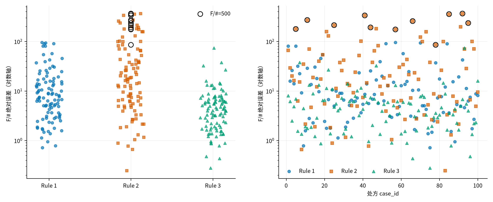
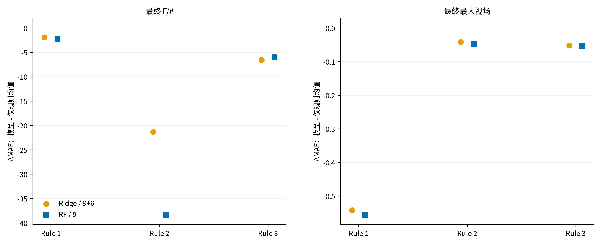
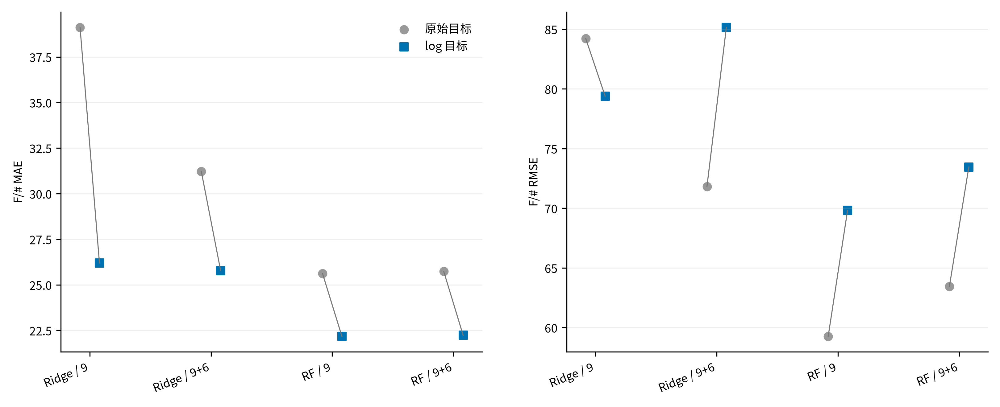
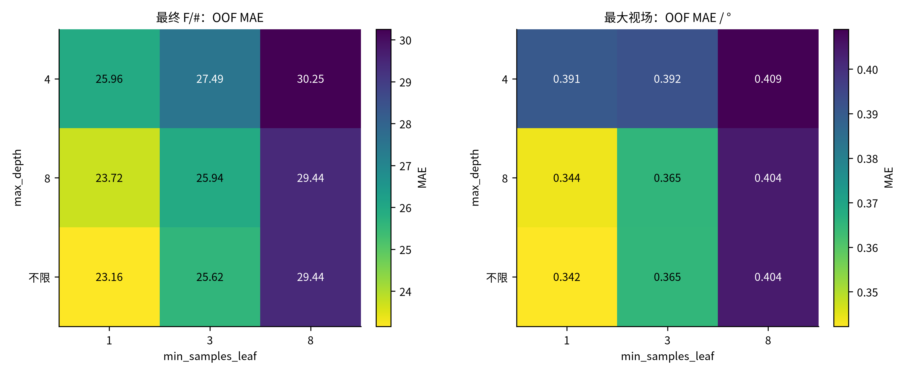

# 第一版回归后续核查：P0–P2

## 总结

F/#=500 不是失败哨兵，也不是 OpticStudio 求解器返回的特殊值。它是 V1 明确设置的初始 F/#。11 个相关终点全部属于 Rule 2：视场阶段先停止，孔径阶段没有启动，因此 F/# 保持初值。处方文件经过保存重载，并通过当前几何和三视场 MTF 检查；从光学验收看它们有效，从学习目标看则是优化策略造成的边界截断值。

最佳 RF/9 的 F/# 误差高度集中在 Rule 2 和这 11 个边界样本。log 目标降低了典型样本 MAE，却进一步低估 F/#=500，使总体 RMSE 与 R²变差。RF 结果对叶节点最小样本数有中等敏感性：`min_samples_leaf=1` 在当前五折上优于 3，但这属于同一验证集上的敏感性观察，不能作为无偏调参结论。

## P0：F/#=500 来源

| 判定项 | 结果 |
|---|---|
| 特殊失败/缺失哨兵 | 否 |
| OpticStudio 显式上界 | 否 |
| V1 初始连续化边界 | 是，`START_F=500` |
| 当前几何和 MTF 验收有效 | 是，11/11 |
| 独立优化得到的孔径最优值 | 否，Rule 2 未启动孔径阶段 |

11 套分别为 case 5、11、25、41、44、57、66、78、85、92、95。最终视场为 2.827°–4.964°；最小几何余量均为正，三视场 MTF 均通过。每组结果哈希、停止原因、MTF 余量和处方重载核查见 `f500_audit.json`。

这类值同时具有两层含义：它是一个真实可用的已验收光学终点，但其数值由规则控制流截断，不表示该处方的最佳 F/# 恰好为 500。后续建模可考虑把‘孔径阶段是否启动/边界状态’作为单独过程建模；本轮保留原始标签，不改变数据。

## P0：F/# 误差分布

| 子集 | n | MAE | RMSE | 绝对误差占比 | 平方误差占比 |
|---|---:|---:|---:|---:|---:|
| F/#=500 | 11 | 241.98 | 255.57 | 34.6% | 68.2% |
| 非 500 | 289 | 17.38 | 34.06 | — | — |

| 规则 | MAE | 中位绝对误差 | P90 绝对误差 | 最大误差 | 绝对误差占比 | 平方误差占比 |
|---|---:|---:|---:|---:|---:|---:|
| Rule 1 | 15.86 | 7.59 | 39.42 | 95.51 | 20.6% | 6.8% |
| Rule 2 | 54.68 | 17.33 | 178.38 | 365.23 | 71.1% | 92.1% |
| Rule 3 | 6.32 | 4.30 | 11.66 | 73.90 | 8.2% | 1.1% |

全体绝对误差中位数为 6.74，P90 为 70.22，最大值为 365.23。误差最大的七行均为 Rule 2 的 F/#=500；case 92、85、41 的绝对误差分别为 365.23、355.76、334.80。非 500 子集 R²为负，原因是模型仍受训练折中的 500 边界混合影响，而移除边界后剩余目标方差显著缩小；这不是建议删除 500 的依据。

## P1：逐规则基线比较

下表比较 RF/9 与训练折内逐规则均值。负 ΔMAE/ΔRMSE、正 ΔR²表示模型更好。

| 输出 | 规则 | 基线 MAE | RF MAE | ΔMAE | MAE 优胜折 | 基线 RMSE | RF RMSE | ΔR² | R²优胜折 |
|---|---:|---:|---:|---:|---:|---:|---:|---:|---:|
| F/# | 1 | 18.102 | 15.855 | -2.247 | 4/5 | 28.774 | 26.776 | 0.139 | 4/5 |
| F/# | 2 | 93.092 | 54.684 | -38.408 | 5/5 | 148.684 | 98.487 | 0.575 | 5/5 |
| F/# | 3 | 12.323 | 6.318 | -6.005 | 5/5 | 16.324 | 10.977 | 0.550 | 5/5 |
| 视场 | 1 | 1.456 | 0.900 | -0.557 | 5/5 | 1.618 | 1.137 | 0.507 | 4/5 |
| 视场 | 2 | 0.141 | 0.093 | -0.048 | 5/5 | 0.306 | 0.250 | 0.344 | 3/5 |
| 视场 | 3 | 0.155 | 0.102 | -0.053 | 5/5 | 0.328 | 0.261 | 0.377 | 3/5 |

RF/9 在六个‘输出 × 规则’组合中均降低 pooled MAE；Rule 2、3 的 F/# 三项指标均为 5/5 折优胜。Rule 1 F/# 为 4/5，视场的 RMSE/R²为 4/5。由此可确认模型学到了处方内信息，而非只复现规则平均值。Rule 2/3 视场本身接近常数，绝对提升较小，解释时仍应看逐规则 R²和真实变化范围。Ridge 与两套特征的完整比较保存在 `per_rule_baseline_comparison.json`。

## P1：log 目标回归

所有模型在训练折对目标取自然对数，预测后指数变换回原始尺度；以下 MAE、RMSE、R²仍在原始 F/# 尺度计算。

| 模型 | 特征 | 原始 MAE | log MAE | 原始 RMSE | log RMSE | 原始 R² | log R² |
|---|---|---:|---:|---:|---:|---:|---:|
| ridge | raw9 | 39.11 | 26.19 | 84.21 | 79.39 | 0.126 | 0.224 |
| ridge | raw9_plus_physics6 | 31.22 | 25.76 | 71.82 | 85.14 | 0.365 | 0.107 |
| random_forest | raw9 | 25.62 | 22.17 | 59.27 | 69.83 | 0.567 | 0.399 |
| random_forest | raw9_plus_physics6 | 25.73 | 22.23 | 63.46 | 73.45 | 0.504 | 0.335 |

RF/9 的 MAE 从 25.62 降至 22.17，但 RMSE 从 59.27 升至 69.83，R²从 0.567 降至 0.399。非 500 样本 MAE 从 17.38 降至 10.08，而 500 样本 MAE 从 241.98 升至 339.77。log 回归确实改善主体分布，但更强地压缩尾部，不能替换原始目标模型；它更适合作为稳健误差偏好的候选或双阶段模型的一部分。视场没有长尾问题，log 目标的四个配置均未改善总体原始尺度指标。

## P2：Random Forest 参数敏感性

固定原始 9 参数、500 棵树、`max_features=sqrt`，只改变 `max_depth ∈ {4,8,不限}` 和 `min_samples_leaf ∈ {1,3,8}`。当前模型为深度不限、叶节点最少 3。

| 输出 | 配置 | MAE | RMSE | R² |
|---|---|---:|---:|---:|
| F/# | depth=不限, leaf=1 | 23.159 | 56.808 | 0.602 |
| F/# | depth=8, leaf=1 | 23.718 | 56.887 | 0.601 |
| F/# | depth=不限, leaf=3 | 25.619 | 59.266 | 0.567 |
| F/# | depth=8, leaf=3 | 25.940 | 59.580 | 0.563 |
| F/# | depth=4, leaf=1 | 25.957 | 58.945 | 0.572 |
| F/# | depth=4, leaf=3 | 27.493 | 60.748 | 0.545 |
| F/# | depth=不限, leaf=8 | 29.435 | 66.344 | 0.458 |
| F/# | depth=8, leaf=8 | 29.443 | 66.210 | 0.460 |
| F/# | depth=4, leaf=8 | 30.253 | 66.499 | 0.455 |
| 视场 | depth=不限, leaf=1 | 0.342 | 0.667 | 0.827 |
| 视场 | depth=8, leaf=1 | 0.344 | 0.666 | 0.827 |
| 视场 | depth=不限, leaf=3 | 0.365 | 0.689 | 0.815 |
| 视场 | depth=8, leaf=3 | 0.365 | 0.689 | 0.815 |
| 视场 | depth=4, leaf=1 | 0.391 | 0.704 | 0.807 |
| 视场 | depth=4, leaf=3 | 0.392 | 0.710 | 0.803 |
| 视场 | depth=不限, leaf=8 | 0.404 | 0.721 | 0.797 |
| 视场 | depth=8, leaf=8 | 0.404 | 0.721 | 0.797 |
| 视场 | depth=4, leaf=8 | 0.409 | 0.724 | 0.796 |

深度从不限限制到 8 的影响很小；深度 4 明显欠拟合。叶节点从 3 降到 1 后，F/# MAE 25.62 → 23.16、R² 0.567 → 0.602；视场 MAE 0.365 → 0.342、R² 0.815 → 0.827，并且两个输出的 MAE 都在五折中 5/5 优于当前 leaf=3。leaf=8 明显退化。

这说明当前结论受叶节点平滑强度影响，但模型家族的总体结论没有反转：RF 仍优于规则均值，F/# 尾部仍是主要困难。因为参数敏感性使用了同一五折结果，leaf=1 不能被报告为无偏‘最优参数’；应冻结候选后用未见的第二批数据一次性验证。

## 文件与限制

本轮没有读取第二批数据、没有运行新的 Zemax 优化，也没有修改第一版结果。`f500_audit.json` 保存逐组物理验收证据；`f_number_error_audit.json` 保存误差贡献；log 和 RF 敏感性的逐行 OOF 预测及指标均保存在同目录。参数敏感性属于模型分析，不构成已完成调参。
