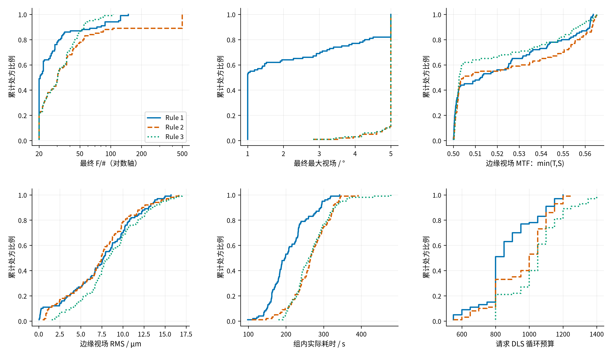
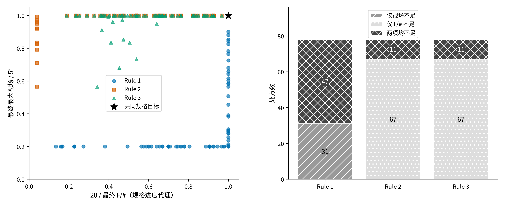
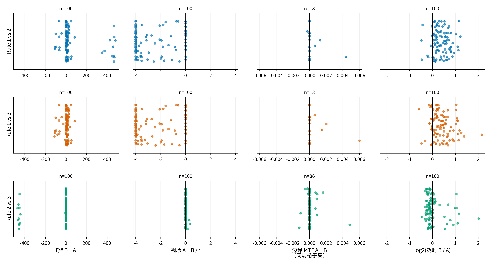
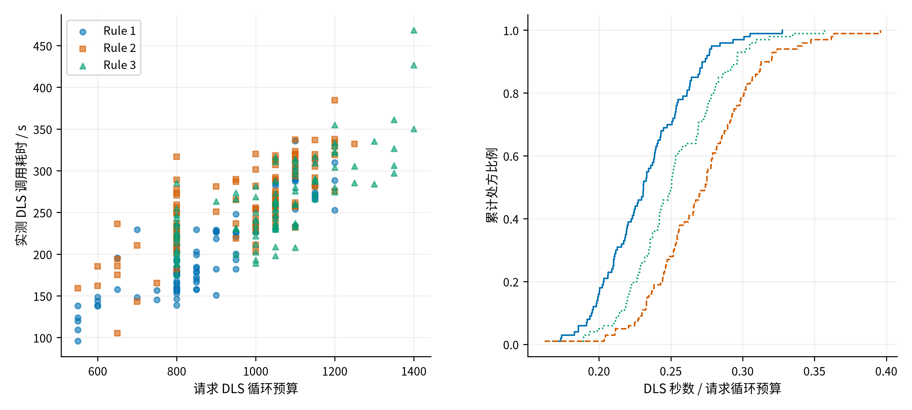

# 前 100 套处方：三条规则可区分性分析

结论：存在明确的规格取舍和少数处方的路径差异，足以支持连续、多目标或集合形式的比较；现有结果不支持为每套处方稳定指定唯一的三分类赢家。Rule 1 与另外两条的差别较强，Rule 2 与 Rule 3 大部分处方相同，少数处方的差别很大。

## 数据与比较口径

100 套独立初始处方，每套三条规则，共 300 个最终接受终点。沿用冻结的成功标签与全部 V1 设置，无新增优化、训练或历史结果改写。共同目标为 F/#=20、最大视场=5°，同时满足现有三视场 MTF 和几何验收条件。

下表为中位数 [第 25, 75 百分位]，完整最小值、最大值、均值、标准差和 5/95 百分位见 analysis.json。MTF 使用各视场 min(T,S)，完整 T、S 值保留在 group_metrics.json。RMS 单位为 μm。三视场随终点最大视场改变，MTF 采样频率随终点改变，因此跨不同规格的 MTF/RMS 分布仅供描述；成像质量的规则优劣只在同一处方、同 F/#、同视场及同采样频率子集比较。

数值平局沿用先前回归核查精度：F/# 与视场 1e-9、MTF 1e-6、RMS 0.001 μm；采样频率匹配精度 1e-9 lp/mm。它们用于识别数值差异，不是工程显著性阈值，也没有改变成功标准。同时报告严格相等数量。单次计时不设置任意“时间平局”阈值。

## 终点与成本分布

| 指标 | Rule 1 | Rule 2 | Rule 3 |
|---|---:|---:|---:|
| F/# | 20.455 [20, 28.621] | 30.543 [21.594, 46.355] | 30.543 [21.594, 42.39] |
| 最大视场 / ° | 1 [1, 3.6769] | 5 [5, 5] | 5 [5, 5] |
| 视场 1 MTF min(T,S) | 0.37757 [0.35409, 0.38864] | 0.38842 [0.3858, 0.38981] | 0.38749 [0.38328, 0.38984] |
| 视场 2 MTF min(T,S) | 0.44385 [0.42237, 0.46464] | 0.46216 [0.45259, 0.4692] | 0.45657 [0.4514, 0.46717] |
| 视场 3 MTF min(T,S) | 0.51271 [0.501, 0.54279] | 0.50473 [0.50167, 0.55351] | 0.50261 [0.50128, 0.53846] |
| 视场 1 RMS / μm | 5.0364 [1.3705, 9.4757] | 1.4193 [0.74131, 2.4723] | 1.8594 [1.0138, 3.3042] |
| 视场 2 RMS / μm | 6.1964 [3.1092, 9.7884] | 4.8166 [2.82, 6.5671] | 5.6156 [4.0375, 7.4711] |
| 视场 3 RMS / μm | 7.6819 [4.4857, 10.241] | 7.4457 [4.6681, 9.8189] | 8.3149 [6.5821, 10.72] |
| DLS 调用耗时 / s | 192.96 [163.73, 229.32] | 259.1 [232.76, 294.58] | 256.95 [229.49, 289.53] |
| 组内实际耗时 / s | 197.55 [167.88, 234.74] | 264.82 [237.51, 300.29] | 263.05 [235.34, 296.34] |
| 请求循环预算 | 800 [800, 950] | 1000 [800, 1100] | 1050 [950, 1150] |

## 78 套全部未达标处方

所有最终接受终点均通过当时的成像和几何验收；“未达标”主要指扩展规格没有达到共同目标。最后一次拒绝的原因只是终止附近的直接障碍，不是对整条失败路径的唯一因果解释。几何原因按组统计，曲面明细可重叠。

| 规则 | 仅 F/# 不足 | 仅视场不足 | 两项不足 | F/# 相对超额中位数 | 视场相对缺口中位数 | 末次 MTF 拒绝 | 末次几何拒绝 |
|---|---:|---:|---:|---:|---:|---:|---:|
| Rule 1 | 0 | 31 | 47 | 10.3% | 80.0% | 42 | 36 |
| Rule 2 | 67 | 0 | 11 | 85.6% | 0.0% | 60 | 18 |
| Rule 3 | 67 | 0 | 11 | 83.6% | 0.0% | 60 | 18 |

F/# 相对超额=(F/#−20)/20；视场相对缺口=(5−视场)/5。两项分别保留，不引入任意加权距离。20/F/# 仅是规格进度代理，不能解释为真实孔径比，因为 EFL 可能变化。逐组缺口、停止原因和几何曲面违规见 failed_78_details.json。

## 逐处方配对比较

下面 A/B 顺序为表中两条规则；规格 Pareto 仅使用较低 F/#、较大视场两个目标。MTF/RMS 没有混入规格 Pareto。

| A vs B | A 支配 | B 支配 | 规格平局 | 规格取舍 | 同规格成像比较 n |
|---|---:|---:|---:|---:|---:|
| 1 vs 2 | 0 | 9 | 18 | 73 | 18 |
| 1 vs 3 | 0 | 13 | 18 | 69 | 18 |
| 2 vs 3 | 1 | 8 | 86 | 5 | 86 |

| A vs B | 指标 | n | A 较优 | 数值平局 | B 较优 | 严格相等 | A−B 中位数 [Q25,Q75] |
|---|---|---:|---:|---:|---:|---:|---:|
| 1 vs 2 | f_number | 100 | 73 | 18 | 9 | 18 | -9.2306 [-21.12, 0] |
| 1 vs 2 | field_deg | 100 | 0 | 18 | 82 | 18 | -3.6595 [-4, -1.3231] |
| 1 vs 2 | requested_cycles | 100 | 56 | 22 | 22 | 22 | -75 [-200, 0] |
| 1 vs 2 | dls_seconds_observed | 100 | 92 | 0 | 8 | 0 | -49.352 [-90.506, -25.112] |
| 1 vs 2 | group_seconds_observed | 100 | 92 | 0 | 8 | 0 | -49.513 [-92.175, -24.876] |
| 1 vs 2 | mtf_min_0_matched_specs | 18 | 6 | 7 | 5 | 0 | 2.179e-09 [-9.2132e-07, 3.3724e-06] |
| 1 vs 2 | mtf_min_1_matched_specs | 18 | 5 | 3 | 10 | 0 | -1.1454e-06 [-4.5441e-06, 1.0473e-05] |
| 1 vs 2 | mtf_min_2_matched_specs | 18 | 8 | 5 | 5 | 0 | 3.5219e-07 [-2.2563e-06, 5.9564e-06] |
| 1 vs 2 | rms_0_um_matched_specs | 18 | 7 | 10 | 1 | 0 | -5.9598e-05 [-0.0013265, 0.00036737] |
| 1 vs 2 | rms_1_um_matched_specs | 18 | 5 | 12 | 1 | 0 | -9.7088e-05 [-0.001344, 0.00028684] |
| 1 vs 2 | rms_2_um_matched_specs | 18 | 3 | 11 | 4 | 0 | -0.00015313 [-0.0007763, 0.00022968] |
| 1 vs 3 | f_number | 100 | 69 | 18 | 13 | 18 | -8.2416 [-17.12, 0] |
| 1 vs 3 | field_deg | 100 | 0 | 18 | 82 | 18 | -3.6592 [-4, -1.3231] |
| 1 vs 3 | requested_cycles | 100 | 66 | 21 | 13 | 21 | -150 [-250, 0] |
| 1 vs 3 | dls_seconds_observed | 100 | 82 | 0 | 18 | 0 | -48.342 [-89.654, -15.343] |
| 1 vs 3 | group_seconds_observed | 100 | 82 | 0 | 18 | 0 | -49.403 [-91.89, -14.738] |
| 1 vs 3 | mtf_min_0_matched_specs | 18 | 4 | 9 | 5 | 0 | 5.1094e-08 [-1.3766e-06, 7.4344e-07] |
| 1 vs 3 | mtf_min_1_matched_specs | 18 | 8 | 4 | 6 | 0 | 3.7637e-07 [-2.179e-06, 1.8744e-05] |
| 1 vs 3 | mtf_min_2_matched_specs | 18 | 7 | 5 | 6 | 0 | 9.8715e-09 [-3.5439e-06, 7.4185e-06] |
| 1 vs 3 | rms_0_um_matched_specs | 18 | 7 | 10 | 1 | 0 | -0.00032654 [-0.0020844, 2.3724e-05] |
| 1 vs 3 | rms_1_um_matched_specs | 18 | 6 | 11 | 1 | 0 | -0.00037997 [-0.0011421, 0.00052092] |
| 1 vs 3 | rms_2_um_matched_specs | 18 | 5 | 8 | 5 | 0 | -1.4257e-05 [-0.0010319, 0.0012728] |
| 2 vs 3 | f_number | 100 | 1 | 86 | 13 | 86 | 0 [0, 0] |
| 2 vs 3 | field_deg | 100 | 5 | 93 | 2 | 92 | 0 [0, 0] |
| 2 vs 3 | requested_cycles | 100 | 13 | 87 | 0 | 87 | 0 [0, 0] |
| 2 vs 3 | dls_seconds_observed | 100 | 26 | 0 | 74 | 0 | 19.004 [-2.2786, 31.402] |
| 2 vs 3 | group_seconds_observed | 100 | 26 | 0 | 74 | 0 | 18.947 [-2.2217, 31.277] |
| 2 vs 3 | mtf_min_0_matched_specs | 86 | 20 | 47 | 19 | 0 | 3.1739e-09 [-2.9131e-07, 8.6065e-07] |
| 2 vs 3 | mtf_min_1_matched_specs | 86 | 42 | 19 | 25 | 0 | 4.5092e-07 [-2.1663e-06, 7.9822e-06] |
| 2 vs 3 | mtf_min_2_matched_specs | 86 | 31 | 21 | 34 | 0 | -1.7554e-08 [-2.9528e-06, 4.2158e-06] |
| 2 vs 3 | rms_0_um_matched_specs | 86 | 14 | 60 | 12 | 0 | -1.4459e-05 [-0.00045838, 0.00024398] |
| 2 vs 3 | rms_1_um_matched_specs | 86 | 15 | 60 | 11 | 0 | -6.6965e-06 [-0.0004981, 0.00045281] |
| 2 vs 3 | rms_2_um_matched_specs | 86 | 17 | 53 | 16 | 0 | 3.7317e-06 [-0.00038179, 0.0004968] |

图中正值表示 A 在对应指标更优；耗时表示本次观测更快，不能解释为跨运行稳定优势。不同指标的优劣方向在配对表中已分别处理。

Rule 2 与 Rule 3：86 套规格平局；Rule 3 在 8 套规格支配 Rule 2，Rule 2 在 1 套支配 Rule 3，另有 5 套发生规格取舍。13 套 Rule 3 的 F/# 更小，其中一部分 Rule 2 停在 F/#=500，导致总体均值差距很大。86 套同规格处方中，边缘 MTF 的差值中位数约 −1.76e-8，边缘 RMS 差值中位数约 3.73e-6 μm；数值差异正负均有，不能据此宣称统一的成像优胜规则。

## 成功、Pareto 与平局集合

成功率：Rule 1 为 18%，Rule 2、3 均为 22%。18 套三条全成功，4 套仅 Rule 2、3 成功（case 1、15、49、84），78 套全部未成功。没有唯一成功规则。

| 集合口径 | 集合：处方数 |
|---|---|
| success_set_distribution | 2,3: 4；none: 78；1,2,3: 18 |
| exact_pareto_distribution | 2,3: 11；1,2,3: 81；3: 2；1,3: 5；1,2: 1 |
| numerical_pareto_distribution | 2,3: 11；1,2,3: 80；3: 2；1,3: 6；1,2: 1 |
| least_cycles_successful_set_distribution | 2,3: 4；none: 78；1,2,3: 17；2: 1 |

严格规格 Pareto 有 98 套包含多条规则，仅 2 套唯一为 Rule 3。数值容差口径使一套原本由末位浮点差异决定的集合发生改变，结果同时保留。22 套有成功规则的处方中，按请求循环预算只有 1 套唯一为 Rule 2，其余 21 套仍有并列。成本集合不等价于实测耗时集合。

## requested cycles 能否代表真实计算成本

300 组 requested cycles 合计 287,100；实际完成循环数 300/300 均缺失（API 未提供计数）。预算与实测 DLS 调用耗时 Pearson=0.809，Spearman=0.799，可作粗略工作量代理，不能称为实际迭代次数或精确耗时。

同为 800 请求循环的 79 组，DLS 耗时 138.68–316.73 s，相差 2.28 倍。处方复杂度、每次迭代耗时、提前收敛、运行时并发竞争与会话时期均可能影响成本；现有日志不能把它们各自的贡献完全分离。13 组较早会话的秒/请求循环中位数 0.211，后续 287 组为 0.251，计时有明显运行环境混杂。

最终采用的 300 组累计 DLS 调用时间 20.141 进程小时；另有 case 2 / Rule 3 的一次已记录重试消耗 1050 请求循环、230.25 s。全部可见记录合计 288,150 请求循环和 20.205 DLS 进程小时。这是并发任务耗时之和，不是日历总耗时；没有完整日志的中断工作可能未计入。

组内实际耗时包含该组优化流程，但不包含 Ray 排队、OpticStudio/API 会话启动和全部失败重试。若未来需要真实端到端成本，应另记调度、会话启动、组执行、重试及总体完成时间；本次没有重新运行优化。

## 对可区分性的判断

1. 规格空间有强信号：Rule 1 与 Rule 2/3 的主要差异是孔径与视场取舍，失败处方同样提供有效信息；不能将 78 套全失败简单视作无信息样本。
2. Rule 2/3 的信号稀疏但存在：86 套规格相同，14 套不同，且部分差异幅度很大。可以研究哪些初始条件触发路径差异；100 套仅提供 14 个这种配对差异样本，尚不足以确认对新处方的稳定预测能力。
3. 同规格成像差异整体较小且方向混合，现有单次运行不能将微小差值与优化数值波动完全区分。没有新增工程显著性标准。
4. 耗时存在观测差异，但并发环境与运行时期混杂；请求循环只能作为预算指标。当前数据适合保留连续表现、Pareto 和平局集合，不能制造唯一三分类真值。

## 审计与文件

所有原始输入、当前采用结果及相关历史状态在读取前后通过 SHA-256 核查；分组标识和结果摘要哈希一致。独立检查 300 组、每套恰好 Rule 1/2/3、所有配对计数、失败类型计数、成功集合与既有标签一致。provenance.json 保存源文件哈希，analysis.json 保存全部统计，group_metrics.json / paired_metrics.json 保存逐组与逐对结果。

## 停止原因补充核对

78 套全失败处方的日志均涉及 step_limit（阶段步数上限），不能解读成已证明物理不可实现。末次 MTF/几何拒绝说明上限附近的受阻表现，未证明耗尽更大预算仍必然失败。

| 规则 | aperture / field 停止原因 | 处方数 |
|---|---|---:|
| Rule 1 | step_limit / not_started_first_stage_limit | 47 |
| Rule 1 | target_reached / step_limit | 31 |
| Rule 2 | step_limit / target_reached | 67 |
| Rule 2 | not_started_first_stage_limit / step_limit | 11 |
| Rule 3 | step_limit / target_reached | 67 |
| Rule 3 | step_limit / step_limit | 11 |

逐处方成功集合与 Pareto 集合见 case_sets.json；独立计数和 307 个源文件哈希核查见 verification.json。
