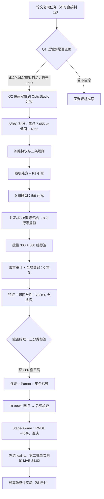

# 思考流程：从"复现论文"到可检验的假设链

> 本文件为只读审阅产物。全部判断仅依据工作区已有文件（源码、冻结清单、日志、JSON、报告）推理，未修改任何源码、结果或历史记录。
> 本文件记录的是**判断如何形成、如何被推翻、如何被修正**，不是结果汇总；结果汇总见 [工作历程技术分析](工作历程技术分析.md)。

---

## 0. 阅读约定

工作区里的材料并不等价，冲突时按以下优先级取值，并在正文标注被推翻的旧结论：

| 等级 | 材料 | 可信理由 |
|---|---|---|
| L1 | 冻结清单 + SHA-256 + 可重放日志 | 前后哈希一致，可逐组复算 |
| L2 | 单次运行结果（JSON/遥测） | 实测，但含环境与并发混杂，不可外推为稳定性能 |
| L3 | 报告正文的解释性文字 | 可能已被后续实验更正，只能当历史观点 |

每条结论都附**可推翻条件**。没有可推翻条件的判断，在本项目里一律不算结论。

---

## 1. 把任务改写成可判定的问题

原始任务是"复现论文"，但它不可判定：论文没有公开完整评价函数、求解预算与规则三的失败轮转方式。直接问"为什么复现不出来"会得到无穷多个并列答案。

因此把任务拆成四个有唯一判定标准的问题：

- **Q1** 论文的近轴解是否被正确复现？——有确定数值，可直接对分。
- **Q2** 偏差来自论文、近轴求解器，还是 OpticStudio 建模？——可通过 A/B/C 对照分离。
- **Q3** 三条规则的结果是否可区分、是否可学习？——需要样本量与统计口径。
- **Q4** 能否在可接受成本与可接受数值误差下批量取得可信标签？——工程问题，但决定 Q3 是否可行。

这个改写决定了整个工作顺序：**先立基准 → 再定位偏差 → 再冻结协议 → 再放大样本 → 最后才谈学习**。后续所有阶段都能映射回这四个问题。

---

## 2. 推理主线（六幕）

| 幕 | 时间 | 当时的问题 | 动作 | 得到的判据 | 遗留问题 |
|---|---|---|---|---|---|
| 一 基线 | 11-17 19:06–19:25 | Q1：近轴解对不对 | 独立实现 `two_lens.py`、`lens_geometry.py`、外部 RayTracing 校验 | d12=8.684220845 mm、k1=0.461541、k2=0.074075、EFL=4.18908，三类残差均在 1e-9 量级 | 外部依赖 `raytracing` 未安装，单测无法运行 |
| 二 定位 | 11-17 19:32–20:34 | Q2：偏差在哪 | A/B/C 三组对照 + Rule 1/2/3 首轮实验 | A 组近轴焦点 7.655 mm vs 像面 1.4055 mm，RMS 106.65 µm → 实现问题，不是论文问题 | 固定厚度/半口径是否为唯一原因 |
| 三 冻结 | 11-17 20:42–11-18 08:08 | 实验结果是否可互比 | `opticstudio_freeze.json`、`opticstudio_three_rules_freeze.json`、`OPTIMIZATION_PROTOCOL.md` | 三规则基线：Rule 1 = F/20 @ 2.5926°，Rule 2/3 = F/27.1114 @ 5° | 规则三的轮转是复现假设，非论文原文 |
| 四 放大 | 08:14–15:22 | Q3 是否具备样本 | 随机处方生成器 → P1 引擎 → 9 组联调 → 后台 300+300 组 → 去重与登记 | 9 组中 5 组达标；200 套处方登记；306 条来源引用；指纹零重复 | 78/100 全失败，失败是否有信息量 |
| 五 算力 | 09:55–11:39 | Q4 是否可承受 | 并发探针、Ray 8 并行、资源归因、线程限制、后台守护 | 8 并行 344.94 s，最低可用内存 1.014 GiB，与串行结果零差值 | 单次计时，不能当稳定加速比 |
| 六 学习 | 18:52–20:31 | 规则能否作为学习目标 | 特征工程 → 可区分性 → 回归 → 后续核查 → Stage-Aware → 独立测试 | 只有"连续 + 集合"标签成立；RF/raw9 独立测试 MAE 34.02 | F/#=500 长尾仍未解决 |

---

## 3. 关键判断的推演记录

每一小节固定四段：**原判断 → 触发证据 → 修正 → 可推翻条件**。

### 3.1 MTFT 的 Param5 是"衍射极限开关"

- **原判断**：审阅 `optimize_opticstudio_rules.py` 时，`MTFT/MTFS` 使用 `(5, 1)`，怀疑第五参数是衍射极限开关，若为真则全部 MTF 目标失效。
- **触发证据**：查 `lib-zemax-programming/.../STAR_Performance_Analysis_Add-on.py` 中 MTFA 的参数顺序为 Samp、Wave、Field、Freq、Grid、Data Type，第五位是 Grid。
- **修正**：不是开关，是网格；该怀疑不成立，未写入任何报告。
- **可推翻条件**：若 ZOS-API 文档给出不同参数表，则需重判。

### 3.2 论文布局长度复现不出来，是论文的问题

- **原判断**：论文给出 14.44850 / 12.49450 mm 两个布局长度，本工作复现不出，初步怀疑论文数值有误。
- **触发证据**：A 组近轴焦点 7.655 mm，而模型像面在 1.4055 mm；初始 RMS 光斑 106.65 µm。若解算器错，薄透镜 EFL 不会与厚透镜矩阵自洽；实际两者自洽，只有成像面错位。
- **修正**：偏差出在"把薄透镜处方直接当成 1 mm 厚平板 + 固定像面"的建模方式，而不是论文。随后 C 组恢复共轭，证明共轭关系本身可解。
- **可推翻条件**：若用真实入瞳 + 可变厚度重跑，仍无法接近论文长度，则论文数值问题重新进入候选。

### 3.3 C 组恢复了共轭，可以直接当论文初始结构

- **原判断**：C 组 `M=-3.463` 已回到目标，可作为"论文初始结构"使用。
- **触发证据**：C 组曲率相对 A 组变化 +15.5% / +10.9%（`c1 0.461541→0.532965`，`c2 0.074075→0.082163`），间隔 7.68422→7.62944 mm。
- **修正**：C 组是"恢复共轭的可行入口"，不是论文原始处方。三规则实验改称"统一入口"，避免把重建结构冒充论文结构。
- **可推翻条件**：若找到论文补充材料给出原始曲率，则 C 组身份需重定。

### 3.4 `step_limit` 是"阶段总步数上限"

- **原判断（第一次）**：Rule 1 在 F/20 停住、Rule 2 在 F/27.11 停住，日志写 `step_limit`，理解为阶段总步数耗尽。
- **触发证据**：`budget_diagnosis_100_v1` 逐步重放 300 组，238 组、249 个维度触发同一条件；推进因子从 0.707 出发，每次拒绝开平方，第 6 次累计拒绝后为 0.994597076（孔径）与 1.005427529（视场），越过 0.99 / 1.01 阈值即停。成功步骤不重置该因子，所以 6 次拒绝不必连续。
- **修正**：`step_limit` 是**自适应步长阈值**，不是步数上限。原 `rule_discriminability` 报告的解释被 `budget_diagnosis` 明确更正，原报告按历史保留不覆盖。
- **可推翻条件**：若 SDK 日志能提供每步 merit 轨迹并显示 DLS 未收敛，则"预算不足"重新成为主因。

### 3.5 F/#=500 是失败哨兵

- **原判断**：11 个终点停在 F/#=500，怀疑是求解器返回的特殊失败值或 API 上界。
- **触发证据**：`f500_audit.json` 显示 11 组全部属于 Rule 2，视场阶段先停止、孔径阶段从未启动；11/11 通过几何与三视场 MTF 验收；处方保存重载后仍有效。
- **修正**：F/#=500 是 V1 明确设定的 `START_F`，是控制流截断值，不是哨兵。它同时是"真实可用的已验收光学终点"和"学习目标里的边界值"，两者都要保留。
- **可推翻条件**：若出现"未进入孔径阶段但 F/#≠500"或"进入孔径阶段却停在 500"的样本，则该等价关系失效。

### 3.6 三条规则可以做成三分类标签

- **原判断**：论文按 High/Middle/Low/Fail 分类，复现后也应给每套处方指定唯一赢家规则。
- **触发证据**：100 套中 78 套三规则全失败；Rule 2 与 Rule 3 有 86/100 套规格完全平局；严格 Pareto 集合里 98 套包含多条规则，仅 2 套唯一为 Rule 3；三规则成功率 18% / 22% / 22%。
- **修正**：不构造唯一三分类真值。标签改为三种集合形式：成功集合、规格 Pareto 集合、请求循环最少集合。Rule 1 与 Rule 2/3 的差异是强信号，Rule 2/3 是稀疏信号。
- **可推翻条件**：若换成更大预算或更细推进阈值后，Rule 2/3 平局大幅减少，则三分类重新可行。

### 3.7 物理派生特征一定有益

- **原判断**：加入间距/EFL、功率比、物像距/EFL 等无量纲量应普遍提升模型。
- **触发证据**：Ridge 的 F/# MAE 39.11→31.22、R² 0.126→0.365；RF 的 F/# MAE 25.62→25.73、RMSE 59.27→63.46（变差），视场几乎不变。
- **修正**：派生特征帮助线性模型表达非线性尺度关系，不提升最好的树模型；结论必须按模型分别表述，不能笼统说"特征有效"。
- **可推翻条件**：若换目标编码或增加样本后 RF 也稳定改善，则该分层结论需改写。

### 3.8 Stage-Aware 两阶段模型可以替代直接回归

- **原判断**：F/#=500 来自"孔径阶段未启动"，先分类阶段状态、再回归，应能消除长尾。
- **触发证据**：分类器 OOF AUC 0.990、未进入类召回 0.818，但少数类仅 11/300 行，某一验证折为 0；硬门控把 8 个有效非 500 行误判为未进入，整体 RMSE 从 56.81 升到 82.65（+45%）；软混合 MAE 30.64 仍差于直接模型 23.16。
- **修正**：Stage-Aware 只保留为机制解释证据，主模型维持 `RF/raw9, leaf=1`；硬门控在当前样本量下不安全。
- **可推翻条件**：获得足够多"未进入孔径"与近边界 Rule 2 样本后，可重新评估门控。

### 3.9 独立测试结果可以回头用于选参

- **原判断**：第二批 100 套测完后，若 leaf=1 更好就固定 leaf=1，若 leaf=3 更好就换回。
- **触发证据**：`model_protocol_freeze_batch1_to_batch2_v1.json` 在读取第二批标签前写入并冻结；测试只执行一次；第二批是同一确定性采样流的后续区段，处方指纹重叠为 0。
- **修正**：测试结果只用于报告，不用于选参。leaf=1 的胜出（MAE 34.02 vs 35.44）被记录为"冻结模型的泛化表现"，而不是"调参依据"。
- **可推翻条件**：任何修改特征/超参的下一版模型都必须另立阶段并使用第三批未触碰数据。

---

## 4. 实验设计原则（为什么这些结论才站得住）

1. **先冻结再实验**。协议、脚本哈希、运行参数、模型清单都在实验前落盘；`opticstudio_workflow_freeze_v1.json` 同时记录上游文件哈希，任何改动都会破坏可追溯性。
2. **留出集只测一次**。第二批的标签在模型全部拟合完成后才读取；预注册文件写明了"单次评估、不做测试驱动选择"。
3. **区分数值平局与工程显著性**。F/#、视场用 1e-9，MTF 用 1e-6，RMS 用 0.001 µm；这些只用于识别浮点差异，不冒充工程阈值。
4. **不美化指标**。Ridge 的负 F/#、负视场与超范围外推原样保留；非 500 子集的负 R² 也保留并解释，而不是裁剪或换口径。
5. **只读重放**。300 组轨迹、906 个源文件、133 个历史文件均先哈希后读取，重放不写回。
6. **成本口径分开**。requested cycles（287,100）不是 completed cycles（300/300 缺失）；DLS 进程小时（20.141 h）不是日历时间；并发求和不是墙钟时间。
7. **工程与科学分离**。后台 runner 的包装层哈希变化被单独审计；核心优化器哈希与冻结参数未变，因此不认定其改变了光学协议。

---

## 5. 决策图

---

## 6. 当前认知边界

**已知（有 L1 证据）**

- 近轴解算器对论文输入自洽，问题不在数学层。
- 三规则基线可复现：Rule 1 = F/20 @ 2.5926°，Rule 2/3 = F/27.1114 @ 5°。
- 100 套处方零重复；随机生成器同种子字节一致；1% 扰动全部被拒。
- 8 并行与串行结果零差值；限线程后数值不变。
- 78/100 全失败的终止原因都是推进因子阈值，不是"物理不可实现"的证明。
- F/#=500 的 11 个终点全部来自 Rule 2 的孔径阶段未启动。

**不确定（单次测量或环境混杂）**

- 并发与 Ray 的耗时只测一次，含冷启动与机器负载，不能当稳定加速比。
- 300 组 requested cycles 与实际耗时 Pearson 0.809，只能当粗略工作量代理。
- "同规格 MTF 差异"整体很小且方向混合，无法与优化数值波动分离。

**未知（现有材料无法回答）**

- 论文真实评价函数、权重与 DLS 预算。
- 每次 DLS 实际完成的迭代数（API 不提供）。
- Rule 3 在论文中的真实首步顺序与失败轮转方式（现有实现是显式假设）。

---

## 7. 下一步的最小可证伪实验

按"能推翻当前最强结论"排序，而不是按工作量排序。

| 优先级 | 实验 | 要推翻的结论 | 判据 |
|---|---|---|---|
| P0 | `budget_52_5_11_v1`：对 case 52/5/11 做每候选 1/2/4 次各 50 循环 | "78 套失败是推进阈值所致，与 DLS 预算无关" | 若增加调用后终点规格改善，则预算成为新主因；若终点不变，原结论加强 |
| P1 | 推进阈值敏感性：0.99/1.01 放宽到更接近 1 | "失败是参数化分辨率限制" | 失败率显著下降则阈值是主因；不变则几何/MTF 约束才是瓶颈 |
| P2 | 放开 t1/t2 与半口径（当前固定 1 mm） | "固定厚度不是复现失败的原因" | 若布局长度接近论文 14.44850/12.49450 mm，则建模限制被证实 |
| P3 | 第三批 201–300 处方预注册 + 单次留出 | 当前模型只在一个留出集上验证过 | 若 MAE 显著劣化，则 leaf=1 的结论不稳健 |
| P4 | 规则三首步顺序消融 | "Rule 3 ≈ Rule 2 是规则本身的性质" | 若换顺序后差异扩大，则 86 套平局来自实现假设 |

**当前正在运行**：`background_runs/budget_52_5_11_v1`，状态 `running`，已见 `case_052_rule_1_calls_1` 等完成记录。

---

## 8. 证据索引

| 判断 | 主要证据文件 |
|---|---|
| 近轴解自洽 | `two_lens.py`、`validate_two_lens.py`、`random_candidates_10/summary.md` |
| A/B/C 偏差定位 | `compare_opticstudio.py`、`opticstudio_comparison/comparison.json` |
| 三规则基线 | `opticstudio_three_rules_freeze.json`、`OPTIMIZATION_PROTOCOL.md` |
| 9 组联调 | `p1_random_3_v1/summary.md`、`cost.json`、`audit.json` |
| 并发与算力 | `opticstudio_concurrency_load/summary.md`、`ray_p1_stress_8_v2/summary.md`、`resource_attribution/report.md` |
| 后台批处理 | `BACKGROUND_RUNNER.md`、`background_runs/*/state.json` |
| 去重与登记 | `dedup_audit_20261118_v2/report.md`、`prescription_registry/global.sqlite` |
| 可区分性 | `rule_discriminability_100_v1/report.md`、`analysis.json` |
| 停止机制更正 | `budget_diagnosis_100_v1/report.md`、`analysis.json` |
| 回归与核查 | `ml_rule_regression_100_v1/report.md`、`ml_rule_regression_followup_100_v1/report.md` |
| Stage-Aware 否决 | `ml_stage_aware_f_number_100_v1/report.md` |
| 独立测试 | `model_protocol_freeze_batch1_to_batch2_v1.json`、`independent_f_number_test_batch2_v1/report.md` |

---

## 9. 一句话总结

这个项目的思考主线不是"把论文跑出来"，而是**不断把不可判定的问题改写成可判定的问题，并为每个判断留下可推翻的证据**：先证明数学层没错，再把偏差钉在建模层；先冻结协议，再放大样本；先证明标签不是唯一三分类，再谈机器学习；最后用一次冻结的留出测试，换取一个不完美但可信的泛化数字。
